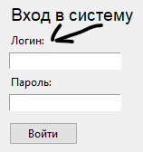
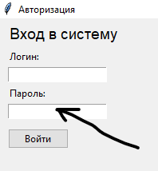
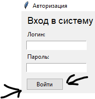

# Назначение
 Предназначен для авторизации пользователей с логином и паролем


# Как открыть:
1. Открываете консоль "Win + R"
2. Переходите в папку где лежит файл cd <путь>
3. и открывете с помощью комманды:
```
Python AUTH.PY
```


# Как пользоваться:

1. Вы видете поле ввода, туда вводить никнейм



2. Здесь поле для ввода пароля, здесь пишем пароль



3. Что бы войти жмём кнопку войти




4. Чтобы убедится здесь должно появится надпись


